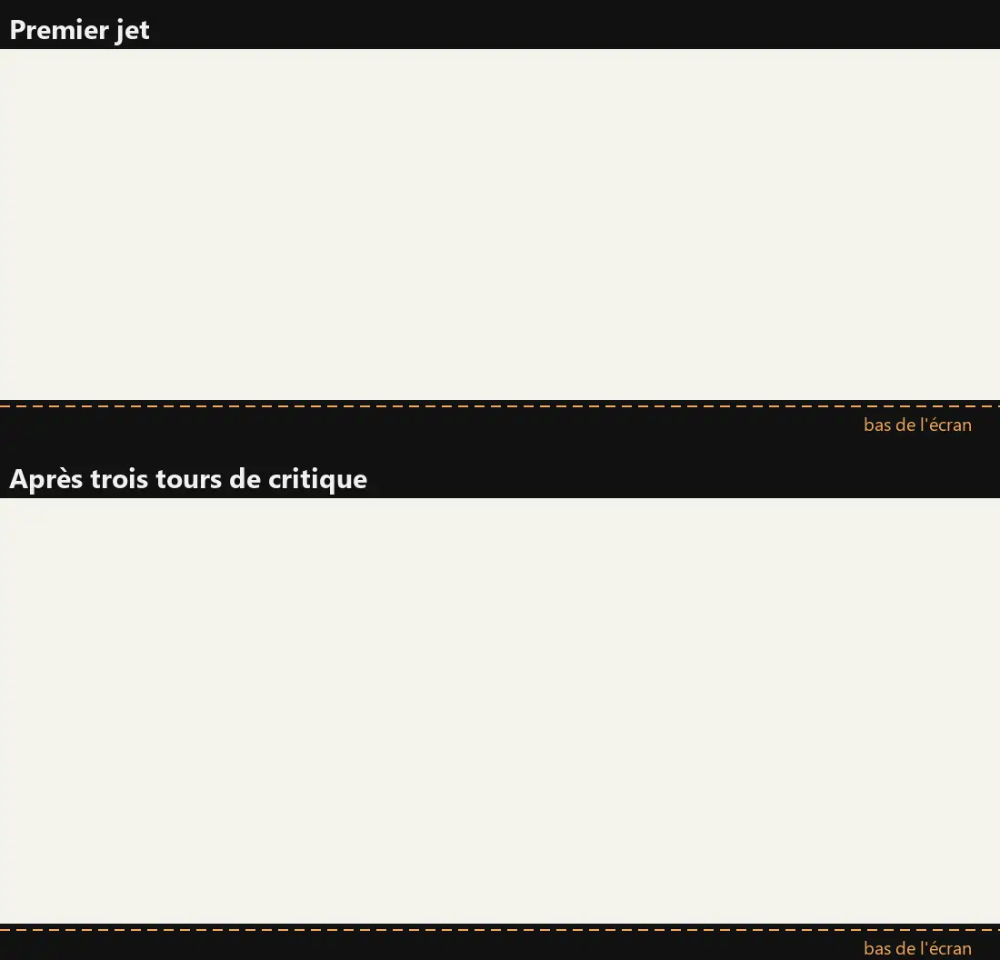
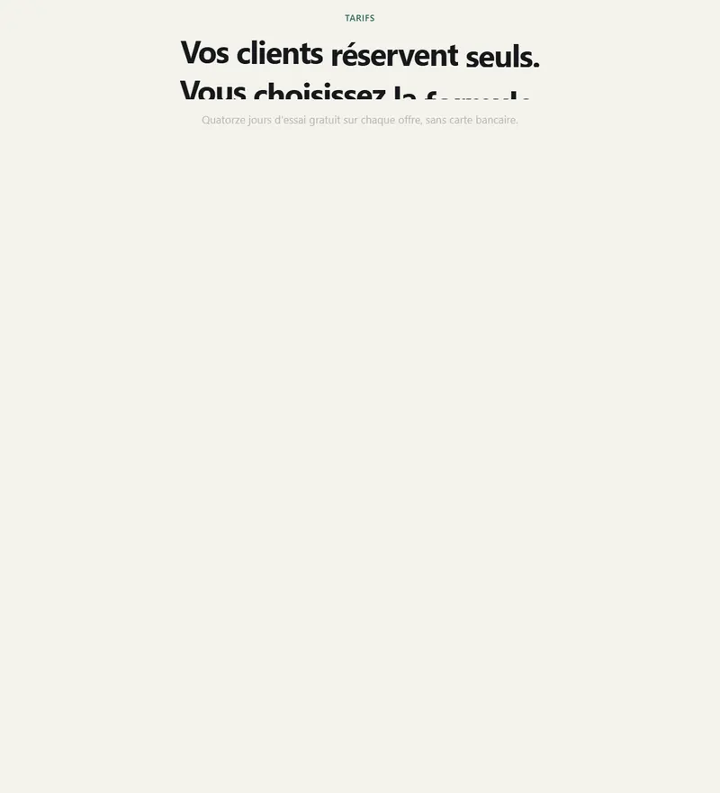
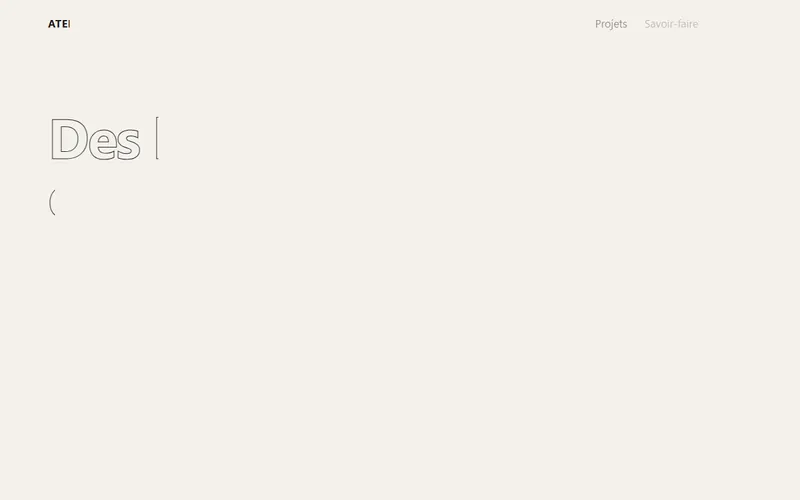
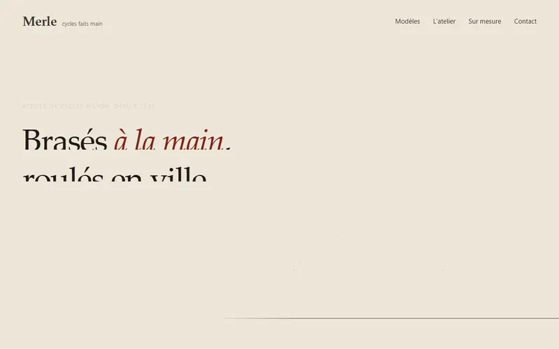
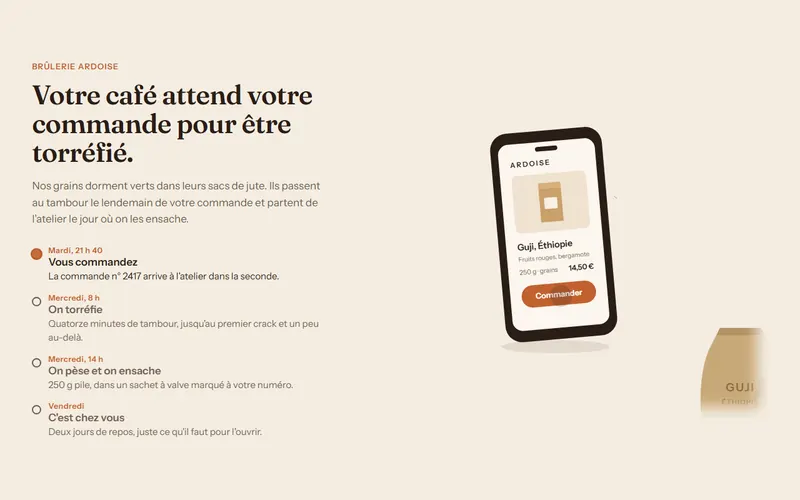
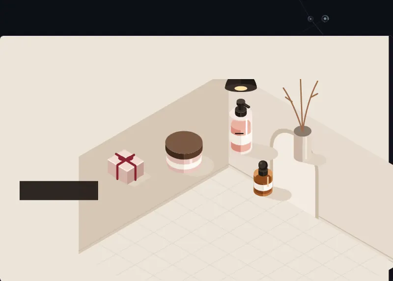
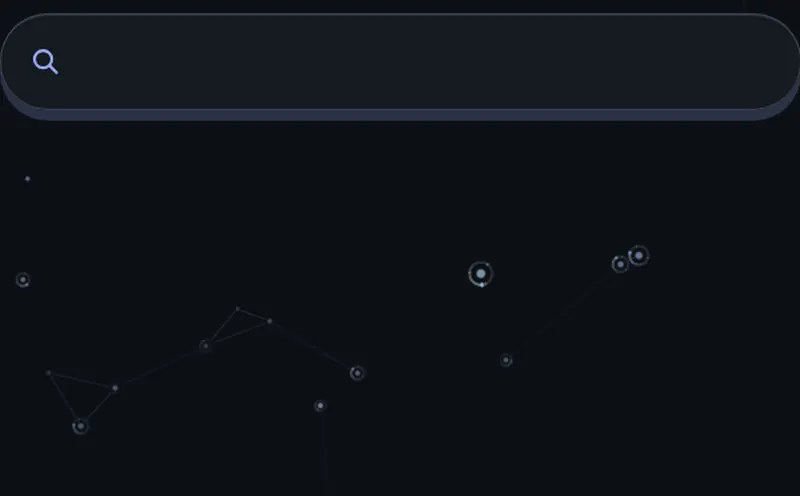

<h1 align="center">Frontmotion</h1>

<p align="center">
  Des animations web qui passent la critique d'un directeur artistique avant que tu les voies.<br>
  Un skill pour Claude Code, Codex, OpenCode et tout agent qui lit les fichiers <code>SKILL.md</code>.
</p>

<p align="center">
  
</p>

<p align="center"><b>En français</b> · MIT · GSAP, CSS ou code sans bibliothèque</p>

Entre son premier jet et la version finale, l'agent a vu et corrigé lui-même :

- des prix qui défilaient depuis « 00 € » à l'arrivée : pendant une seconde, on lisait des prix qui n'existent pas ;
- les boutons « Essayer » sous le bas de l'écran ;
- une étiquette « Le plus choisi » qui traversait la carte puis rebondissait ;
- un sélecteur qui traînait, et le mot « Annuel » blanc sur blanc pendant le glissement ;
- des chiffres illisibles pendant le changement de prix, les dizaines descendant pendant que les unités montaient ;
- une page qui ne bougeait plus du tout après l'arrivée.

---

## Pourquoi

Un agent sait écrire une belle animation. Ce qu'il fait mal, c'est la regarder. Il la livre au premier jet, sans avoir vu
que le titre saute à la fin, que la page s'arrête morte après trois secondes ou que tout démarre en même temps.

Frontmotion lui fait faire ce que fait un directeur artistique exigeant : **il filme son animation, la critique, et la
reprend**, deux ou trois fois, avant de te la montrer. Il est né d'un vrai site où aucune animation n'a été bonne du
premier coup, et où chacune est devenue excellente à force de critiques précises. Il transmet cette boucle, pas un
style : chaque projet trouve son propre mouvement.

## Comment ça marche

1. **Un premier jet ambitieux.** Une vraie mise en scène, un moment fort, un mouvement lié au sujet du site.
2. **Le regarder pour de vrai.** Image par image avec une horloge figée, les courbes de vitesse de chaque élément, l'image
   finale seule, un vrai geste de défilement et de souris, un téléphone.
3. **Le critiquer** avec une grille de quatorze questions, chacune tirée d'un vrai retour : « que voit-on à la fin ? »,
   « est-ce rigide ? », « comprend-on le rôle de chaque élément ? », « est-ce générique ? »… Au moins trois défauts par
   tour, avec la preuve.
4. **Corriger et recommencer**, jusqu'à ce que ce qui reste relève du goût et plus du défaut.

## Ce qu'il attrape

- un titre qui saute de 7 px à la fin de son animation ;
- un agenda qui reste vide parce qu'une transition CSS et GSAP se battent pour la même propriété ;
- un vélo en construction qui chevauche le texte pendant une seconde ;
- une page d'accueil où plus rien ne bouge après 3,6 s ;
- cinq lueurs qui brillent en même temps : on ne sait plus où regarder ;
- une étiquette et des garde-boue qui apparaissent de nulle part ;
- une animation à 35 images par seconde sur un ordinateur moyen, à cause d'un feuillage ;
- des roues qui tournent autour de leur coin au lieu de leur centre ;
- des libellés qui disparaissent en blanc sur blanc pendant un glissement.

Testé à l'aveugle face au même modèle sans le skill, sur quatre demandes : il ne fait jamais moins bien, et il fait
mieux sur les interfaces et les pages à reprendre.

## Des démonstrations concrètes

<table>
  <tr>
    <td width="50%"></td>
    <td width="50%"></td>
  </tr>
  <tr>
    <td><b>Une page de tarifs</b><br>Les prix roulent, l'agenda de l'offre mise en avant se remplit et continue de vivre, l'annuel barre l'ancien prix.<br><a href="demos/tarifs.html"><code>tarifs.html</code></a></td>
    <td><b>Une page existante, reprise</b><br>Un studio d'architecture aux animations génériques : tout est maintenant tracé comme un plan, puis construit.<br><a href="demos/architecture.html"><code>architecture.html</code></a></td>
  </tr>
  <tr>
    <td></td>
    <td></td>
  </tr>
  <tr>
    <td><b>Une section d'accueil</b><br>Le vélo se fabrique sous les yeux, puis prend son élan. Après l'histoire, la page continue de vivre.<br><a href="demos/velo.html"><code>velo.html</code></a></td>
    <td><b>Une illustration qui raconte</b><br>Le parcours d'une commande de café, en un plan-séquence, de la commande à la porte du client.<br><a href="demos/torrefacteur.html"><code>torrefacteur.html</code></a></td>
  </tr>
</table>

## Né d'un vrai projet

Deux sections de mon portfolio professionnel, le projet d'où vient ce skill.

<table>
  <tr>
    <td width="50%"></td>
    <td width="50%"></td>
  </tr>
</table>

## Installation

Clone-le là où ton agent cherche ses skills.

```bash
# Claude Code
git clone https://github.com/mehdibml/frontmotion ~/.claude/skills/frontmotion
# Codex
git clone https://github.com/mehdibml/frontmotion ~/.codex/skills/frontmotion
# OpenCode
git clone https://github.com/mehdibml/frontmotion ~/.config/opencode/skills/frontmotion
```

Pour un seul projet, clone-le dans le dossier de skills du projet (`.claude/skills/`, `.opencode/skills/`…). Avec un
autre agent, demande-lui de lire `SKILL.md` avant d'animer.

Les outils demandent Node 20 ou plus récent, et Playwright :

```bash
cd ~/.claude/skills/frontmotion   # ou l'endroit où tu l'as cloné
pnpm install                      # ou npm install
pnpm exec playwright install chromium
```

[ffmpeg](https://ffmpeg.org/) est facultatif.

## Utilisation

L'agent charge le skill dès qu'on lui demande d'animer quelque chose, ou qu'une animation paraît rigide, générique,
pauvre ou trop chargée.

- « Anime la section d'accueil de ma boutique. »
- « Fais une illustration animée qui explique notre service. »
- « Les animations de cette page font générique, rends-la plus marquante. »
- « Ce menu est raide, reprends-le. »

## Les outils

```bash
node scripts/capture.mjs page.html --selecteur ".hero" --fin 4000 --pas 100      # planche image par image
node scripts/capture.mjs page.html --suivre ".titre,.visuel" --fin 4000          # courbes de mouvement
node scripts/capture.mjs page.html --defilement 0:3000:40,3000:0:-60             # au défilement, aller et retour
node scripts/capture.mjs page.html --parcours trajet.json --animation webp       # survols, clics, glisser, clavier
node scripts/fluidite.mjs page.html                                              # images par seconde, processeur ralenti
node scripts/telephone.mjs page.html                                             # vrai profil tactile, débordements
```

- **`capture`** : chaque image de l'animation, exacte, sur ordinateur ou sur téléphone.
- **Les courbes de mouvement** repèrent un mouvement rigide, trop brusque, ou des éléments qui partent tous ensemble.
- **`fluidite`** et **`ralentissements`** : la fluidité sur un ordinateur moyen, et ce qui la plombe.
- **`telephone`** : la page parcourue au doigt.

## Pour toi qui donnes les retours

L'agent critique son travail, mais tu restes le directeur artistique. [`GUIDE.md`](GUIDE.md) : comment demander, comment
regarder, et comment dire ce qui ne va pas pour que ce soit corrigé en un tour plutôt qu'en cinq.

## Contenu du dépôt

```text
SKILL.md                 la boucle et la grille de critique
GUIDE.md                 pour la personne qui juge
references/pieges.md     pièges techniques : performance, téléphone, vidéo, 3D
scripts/                 capture, fluidité, ralentissements, téléphone
demos/                   quatre pages faites avec le skill
medias/                  les animations de ce README
```

## Licence

MIT, voir [`LICENSE`](LICENSE). © 2026 Mehdi Ben.
